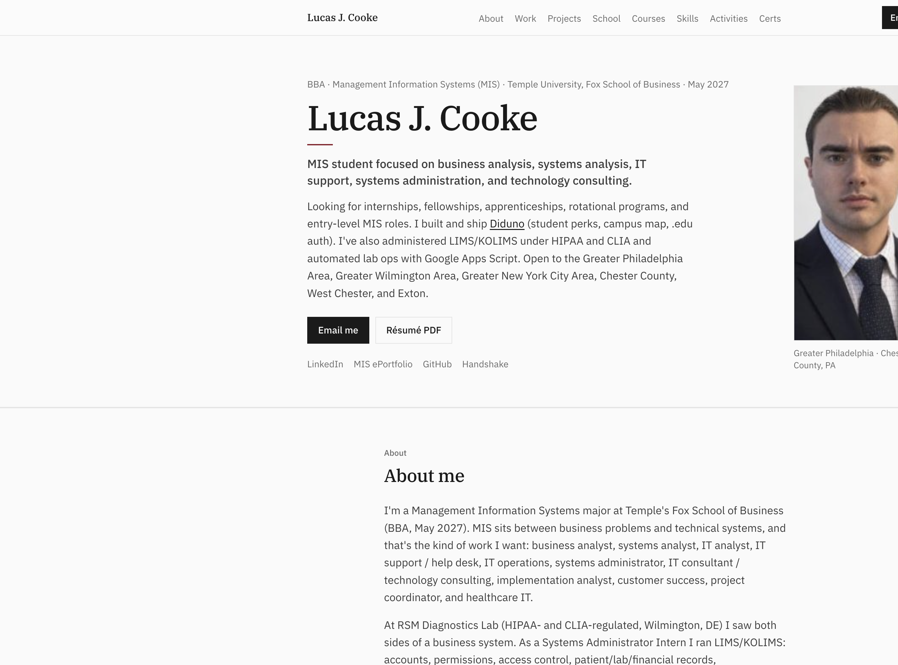

# Lucas J. Cooke

MIS student at Temple's Fox School of Business. This repo is the source for my site:

**[lucascooke.site](https://lucascooke.site)**

  

  <a href="https://lucascooke.site">lucascooke.site</a>
  ·
  <a href="./assets/resume/Lucas-J-Cooke-Resume.pdf">Résumé PDF</a>
  ·
  <a href="https://www.linkedin.com/in/lucas-cooke">LinkedIn</a>
  ·
  <a href="https://diduno.org">Diduno</a>

BBA · Management Information Systems · May 2027

Looking for MIS internships and entry-level roles in the Philly, Wilmington, and New York areas.

---

## About

I'm an MIS major at Temple Fox. I want roles where I work the business problem and the system behind it: analyst, systems admin, IT support, implementation, consulting, healthcare IT.

At RSM Diagnostics Lab in Wilmington (HIPAA and CLIA) I started as a Systems Administrator Intern on LIMS/KOLIMS. Came back full-time as Partner Relations Coordinator and Account Manager. Built partner onboarding, handled accounts, shipped [rsmdiagnosticslab.com](https://rsmdiagnosticslab.com), and wrote Google Apps Script for shipping and account ops.

On my own time I build [Diduno](https://diduno.org) for Temple students. Before Fox I studied finance at West Chester (Dean's List, Fall 2024) and transferred into MIS in Fall 2025.

## Work

**Partner Relations Coordinator and Account Manager** · RSM Diagnostics Lab · May 2026 – Aug 2026

- Managed partner accounts for a HIPAA/CLIA diagnostics lab
- Outreach and sales support for new and existing accounts
- Designed and shipped the company website (forms + Document Center)
- Wrote onboarding for new partner practices (no process existed before)
- Google Apps Script automations for shipping, receiving, logistics, and account ops

**Systems Administrator Intern** · RSM Diagnostics Lab · May 2025 – Aug 2025

- Day-to-day LIMS/KOLIMS administration
- Patient, lab, and financial records
- KOLIMS accounts and permissions under HIPAA and CLIA
- SOPs, spreadsheets, and tracking the team used daily

Earlier roles: Movie Tavern, Walmart, The Deck Hand (Chester County).

## Projects

**[Diduno](https://diduno.org)** · Founder / builder · Oct 2026 – present

Student product for Temple: .edu perks, campus map, live finds, events, forum, Microsoft school sign-in. Next.js, TypeScript, Postgres. About 50 of my commits are in the app.

**[RSM Diagnostics Lab website](https://www.rsmdiagnosticslab.com)** · Jun 2026 – Aug 2026

Company site, forms, and Document Center materials.

**Lab ops automations** · 2025 – 2026

Apps Script for shipping, receiving, logistics, specimen coordination, and account admin.

## School

**Temple University · Fox School of Business** · Aug 2025 – May 2027  
BBA, Management Information Systems

**West Chester University** · Aug 2023 – May 2025  
Finance coursework before transferring. Dean's List, Fall 2024.

## Contact

- Email: [l.jcooke@icloud.com](mailto:l.jcooke@icloud.com)
- Site: [lucascooke.site](https://lucascooke.site)
- LinkedIn: [linkedin.com/in/lucas-cooke](https://www.linkedin.com/in/lucas-cooke)
- MIS ePortfolio: [community.mis.temple.edu/lcooke](https://community.mis.temple.edu/lcooke)
- Handshake: [app.joinhandshake.com/profiles/lucas-cooke](https://app.joinhandshake.com/profiles/lucas-cooke)
- GitHub: [github.com/Lukee-bit](https://github.com/Lukee-bit)
